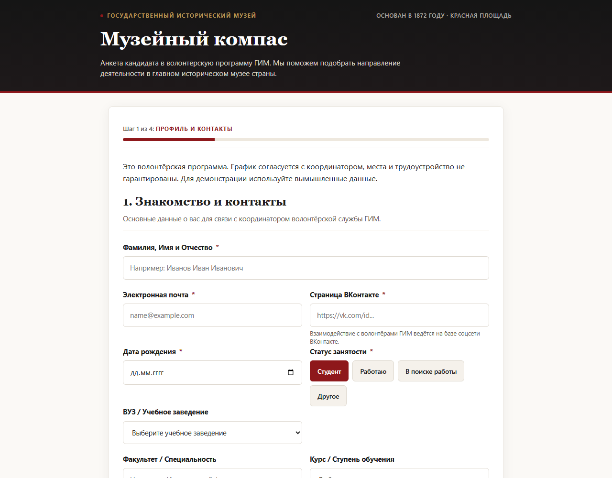
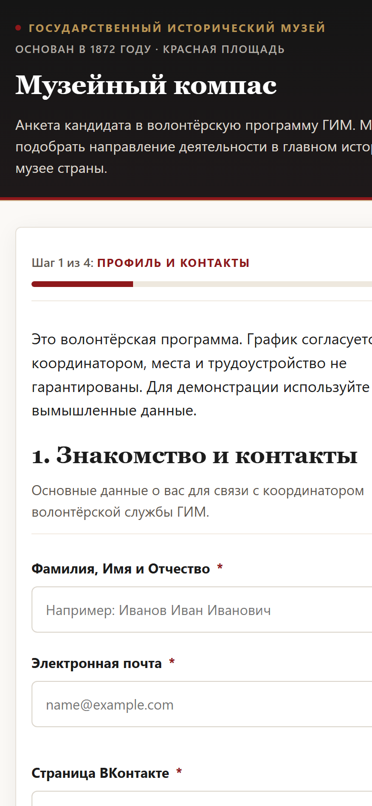

# Музейный компас

**Отбор волонтёров для Государственного исторического музея с помощью LLM**

Хакатон ВШЭ «Код со смыслом 2» · 21–22 октября 2026 · кейс ГИМ

> *EN:* A volunteer-application service for the State Historical Museum (Moscow), built in two days at an HSE hackathon. A candidate fills in a web form or talks to a VK bot; an LLM asks up to three clarifying questions **before** forming an opinion, scores five museum criteria with quotes from the answers as evidence, and hands the coordinator a preliminary verdict and interview topics. Data lands in SQLite and Google Sheets idempotently. The human always makes the decision.

<p align="center">
  
  &nbsp;
  
</p>

## Задача

В каждый набор волонтёрская программа ГИМ получает до полутора сотен анкет. Координаторы вручную читают свободные ответы и решают, кого звать на собеседование и в какое направление. Анкета при этом часто не даёт ответа на главное: сможет ли человек регулярно приходить и чем он действительно хочет заниматься.

## Решение

```
 кандидат ──► веб-анкета (4 шага) ─┐
          └─► бот ВКонтакте ───────┤
                                   ▼
                       FastAPI ── уточняющий агент (LLM)
                          │          до 2 вопросов + 1 повторный,
                          │          только по реальным пробелам
                          ▼
                       оценщик (LLM): 5 критериев 0–3,
                       каждая оценка с цитатой-доказательством
                          │
            ┌─────────────┼──────────────────┐
            ▼             ▼                  ▼
         SQLite     Google Sheets     кабинет координатора /admin
     (идемпотентно) (строка на ID)    рейтинг, аналитика, CSV
```

1. **Сначала уточнить, потом оценивать.** Агент читает анкету и, если по какому-то критерию не хватает данных, задаёт кандидату до двух вопросов. После ответов — максимум ещё один, если осталось важное противоречие. Если всё ясно, вопросов нет.
2. **Оценка с доказательствами.** Пять критериев музея оцениваются по шкале 0–3 или `null` при нехватке данных. Каждая оценка подкрепляется дословной цитатой из анкеты. Сервер проверяет, что цитата действительно там есть, и сам считает итоговый балл.
3. **Результат для куратора, а не для кандидата.** Предварительный вердикт, сильные стороны, риски, рекомендуемое направление и до двух тем для собеседования. Кандидат видит только подтверждение.
4. **Решение принимает человек.** Автоматического отказа нет. Шкала помечена как пилотная, пока не откалибрована на решениях кураторов.

## Инженерные решения

- **Идемпотентная отправка.** ID заявки резервируется в SQLite до вызова медленной модели. Повторная и параллельная отправка с тем же ID не создаёт дублей и не вызывает модель ещё раз. Зависший резерв освобождается, а вместо ошибки 500 возвращается 409 с `Retry-After`.
- **Google Sheets — одна строка на заявку.** Перед записью сервер ищет ID и обновляет найденную строку. Если ответ Google потерялся, повторная синхронизация найдёт строку, а не продублирует её. При сбое Google анкета остаётся в SQLite, синхронизацию можно повторить через `POST /api/v1/applications/{id}/sync`.
- **Строгий контракт с LLM.** Ответ модели проходит валидацию по JSON-схеме. При нарушении формата допускается один запрос на исправление в рамках таймаута. Подходит любой OpenAI-совместимый endpoint; в хакатоне использовался DeepSeek через ReformBoss.
- **Работает без ключа.** Режим `rules_demo` даёт детерминированную демо-оценку по правилам, поэтому проект можно запустить и протестировать без платного API.
- **Персональные данные.** Явное согласие (сервер отклоняет заявку без него), проверка 18+, кабинет координатора закрыт токеном, отправка во внешнюю LLM включается только явным флагом `GIM_ALLOW_EXTERNAL_LLM=1`. В репозитории только синтетические анкеты.
- **ВКонтакте.** Бот на Bots Long Poll проходит тот же диалог, что и веб-форма: уточнения, оценку, повторную отправку без дублей. Состояние сессий хранится в SQLite.

## Стек

Python 3.11+ · FastAPI · Pydantic · SQLite · Google Sheets API (service account) · VK Bots Long Poll · HTML/CSS/JS без фреймворков · pytest

## Запуск

```bash
git clone https://github.com/Ai-b0ss/code-with-purpose-2-2026.git
cd code-with-purpose-2-2026
python -m pip install -r requirements.txt
python -m uvicorn backend.app:app --host 127.0.0.1 --port 8765
```

Откройте http://127.0.0.1:8765. По умолчанию работает `rules_demo`, ключи не нужны.

| Переменная | Назначение |
|---|---|
| `GIM_EVALUATION_MODE=llm`, `GIM_LLM_ENDPOINT`, `GIM_LLM_MODEL`, `GIM_LLM_API_KEY` | настоящая LLM (полный URL `/v1/chat/completions`) |
| `GIM_ALLOW_EXTERNAL_LLM=1` | разрешить отправку анкет во внешнюю модель |
| `GIM_GOOGLE_SPREADSHEET_ID`, `GIM_GOOGLE_CREDENTIALS_FILE` | запись в Google Sheets |
| `GIM_COORDINATOR_TOKEN` | ключ кабинета `/admin` (не короче 32 символов) |

Значения можно положить в `.env` в корне (файл в `.gitignore`). Подробно: [первый запуск](docs/10-first-run.md), [настройка LLM](docs/11-llm-evaluator.md), [эксплуатация](docs/operations.md). Бот ВКонтакте: `python -m vk_bot.bot`.

Тесты: `python -m pytest -q`. Им не нужны сеть и ключи.

## Команда

| Участник | Роль |
|---|---|
| **Игорь Глуховский** ([@Ai-b0ss](https://github.com/Ai-b0ss)) | капитан, продукт и техническое руководство: архитектура, интеграция backend/LLM/VK, приёмка, защита |
| **Илья Соколов** | веб-анкета и UX, прогон анкет, CSV |
| **Ева Шишкина** | критерии отбора, синтетические профили, экспертные ожидания для проверки модели |
| **Александр Мирошниченко** ([@r0shn1ch](https://github.com/r0shn1ch)) | Google Sheets, подготовка RAG-пилота |

## Ограничения

- Шкала 0–3 — пилот. Независимой калибровки на исторических решениях кураторов не было.
- Сервис рассчитан на локальный запуск. Для публичного сбора реальных анкет нужны хостинг, отдельная политика обработки ПД и закрытие API данных ([#28](https://github.com/Ai-b0ss/code-with-purpose-2-2026/issues/28)).
- Целевое время заполнения 5–7 минут на реальных кандидатах не замерялось.

## Документы

[Требования музея](docs/04-gim-requirements.md) · [Ответы эксперта](docs/06-gim-stakeholder-answers.md) · [Архитектура](docs/architecture.md) · [Протокол оценки](docs/evaluation-protocol.md) · [Пилотная шкала](docs/20-gim-scoring-pilot-20261022.md) · [ПД и безопасность](docs/privacy-and-security.md) · [Журнал хакатона](docs/hackathon-log.md) · [Сборки](https://github.com/Ai-b0ss/code-with-purpose-2-2026/releases/tag/hackathon-2026-10-22)
