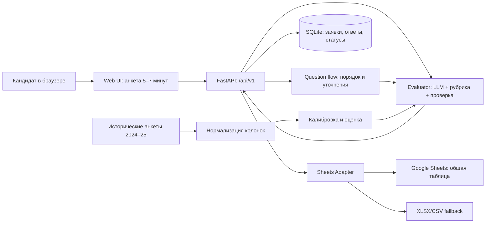

# ГИМ / Архитектура MVP v0.1 — на обсуждение команды

**Статус:** архитектурное предложение, не утверждено разработчиками. **Источник:** оригинальные ТЗ и анкеты ГИМ из `materials/gim`, интервью с куратором 21.10, [протокол ответов](06-gim-stakeholder-answers.md). **Не путать** «Кейс 2. ГИМ» (папка организаторов) и №3 (сайт).

## 0. Продуктовое решение (важнее технологий)

**За 5–7 минут** кандидат рассказывает о себе и своих ожиданиях, получает контекстные уточнения, а координатор — одну запись в **Google Sheets** с вопросами/ответами, итоговой оценкой **0–3**, саммари, сомнениями, рекомендуемым направлением и вопросами для очного интервью.

**Приоритеты заказчика:** (1) качество рекомендаций; (2) согласие с оценками кураторов; (3) прогноз будущей активности. **VK предпочтительнее**, но **творческий веб-сайт разрешён**. Графики и отдельный кабинет координатора отложить до сквозного результата.

## 1. Структура системы



**Один сервер, один процесс, один источник истины.** Не нужно микросервисов, брокеров, трёх frontend-стеков или отдельного обучения тяжёлой модели.

## 2. Технологии и границы

| Слой | Предложение | Почему | Владелец |
|---|---|---|---|
| UI | HTML/CSS/vanilla JS; при желании Vite без React | знакомо Илье, минимум сборки | Илья |
| HTTP и логика | Python 3.11+ / FastAPI + Pydantic | быстро определить проверяемый контракт | Саня (по прибытии), Игорь для стыковки |
| Хранение | SQLite; уникальные `application_id` и `external_row_id` | просто запускать и избегать дублей | Саня |
| Анкета | Явный набор вопросов + state machine + адаптивные короткие уточнения | 5–7 минут по смыслу, а не фиксированному числу | Илья + Игорь |
| Оценщик | LLM-адаптер + версия рубрики + строгая JSON-схема; fallback | качественные обоснования и повторяемый формат | Игорь |
| Результат | Google Sheets API, резерв XLSX/CSV той же схемы | это прямо запросил музей | Саня |
| QA | Ручные кейсы и тайминг UX, regression fixtures | реалистично за сутки | Ева |

**Предпочтительная инфраструктура MVP:** всё поднимается локально; публичная ссылка возможна при наличии времени. Google Sheets подсоединяем, когда будет конкретный способ авторизации; резервный CSV не блокирует демо.

## 3. Сквозной пользовательский поток

1. **Знакомство с программой.** Несколько предложений о реальных задачах музея; затем ввод обязательных полей анкеты.
2. **Анкетирование.** Комбинация быстрых переключателей и коротких текстовых ответов. Прогресс, возможность исправить ответ. Не фиксируем число вопросов: ограничиваем среднее *время*.
3. **Уточнения.** 0–3 предложения по непрояснённым аспектам (если ответ уже содержательный, пропускаем). Ключевые темы: мотивация, реальные часы/график, направление, опыт, возможные ограничения.
4. **Двусторонняя рекомендация.** Как кандидат может помочь музею; насколько выбранное направление соответствует ожиданиям кандидата; какие дополнительные сведения нужны куратору.
5. **Оценка.** Возвращаем обоснованные сильные стороны, проблемы, направление, вопросы собеседования, предсказанную оценку 0–3 (если калибровка готова).
6. **Таблица координатора.** Одна строка на заявку, воспроизводимый набор колонок, экспорт без повторов; решение и комментарий куратора можно записать в соседние столбцы.

Статусы сессии: `draft → clarifying → ready_to_submit → scored → exported`. Ошибку оценки/отправки храним отдельно, не теряем заполненную анкету.

## 4. Контракт API v1 (не ломать без обсуждения)

```text
GET    /api/v1/health                     → {status, version}
POST   /api/v1/sessions                   → {session_id, next_question, progress}
POST   /api/v1/sessions/{id}/answers      → {next_question, progress, ready_to_submit}
POST   /api/v1/sessions/{id}/submit       → {application_id, evaluation_status}
GET    /api/v1/applications/{id}          → {application, evaluation, export_status}
POST   /api/v1/applications/{id}/export   → {status, external_row_id?}
GET    /api/v1/applications               → {items, total}
```

Отдельный [машиночитаемый контракт JSON](../contracts/application-v1.schema.json) и [синтетический пример](../contracts/example-evaluation.json). UI сначала ходит в mock-реализацию тех же методов — не ждёт Сани.

*Важная тонкость:* `POST submit` и `POST export` идемпотентны по `application_id` (повторный клик не создаёт новую анкету/строку).

## 5. ИИ-оценщик: не «магический скоринг»

```text
Исходные ответы
   ↓
Факты + полнота + противоречия (структурный разбор)
   ↓
Рубрика из кураторских решений: пять групп критериев
   ↓
Двусторонняя рекомендация + объяснения, вопросы интервью
   ↓
Оценка 0–3 (после калибровки и проверки)
   ↓
Строгий JSON + проверка схемы
```

**Не строить скоринг только на демографии и статусах.** Первый курс, полная занятость или другие волонтёрства — сигналы для уточнения *реальной* доступности, а не жёсткий отказ: музей отдельно оговорил исключения.

Итоговое мнение человека **не** подменяется моделью; основное назначение — качественные рекомендации и сокращение чтения анкет.

### Как выводим приоритеты из истории

- Есть 206 строк-кандидатов в 3 листах, **112 с заполненными баллами** 0–3. Весна 2025: 149 строк, но только 55 размеченных. Не трактовать пустое поле как 0.
- Сначала сопоставить разные названия столбцов между 2024 и 2025, нормализовать вопросы и оценки.
- На примерах оценок 0, 1, 2, 3 изучить характерные признаки; проработать исключения по занятости.
- Создать **версионируемую рубрику** с объяснением каждого критерия; эксперт музея утверждает её. **Не объявлять автоматически выведенные веса «официальной методикой».**
- Использовать отдельную проверочную часть данных, не смешивать с примерами в промптах.
- Измерять: экспертную полезность рекомендаций (ручная оценка), MAE балла, долю точных совпадений, матрицу расхождений по 0–3, среднее время анкеты.
- Аналитику реальной активности/удержания делать после хорошей основной функции.

Набор данных небольшой и неоднородный, поэтому полный ML-training — неоправданный риск.

## 6. Таблица (основной результат для музея)

Созданный [шаблон Google Sheets](https://docs.google.com/spreadsheets/d/1AJVzUTu8KJPfknSgQBem5InL3q_ynAQ3qSO2h8bDVSc/edit): вкладки «Анкеты» (36 колонок), «Рубрика», «Инструкция».

**Обязательно в строке:** ID, время, вопросы и ответы, score, summary, concerns, recommended_direction, direction_rationale, interview_questions, curator_decision/comment. Шаблон ещё не связан с приложением. **Сначала согласовать именование полей**, потом записывать.

## 7. Ветвление работы и интеграция

```text
main — только проверенный вертикальный сценарий
├─ feat/applicant-ui        → Илья (UI + mock)
├─ feat/evaluator           → Игорь (JSON + модель)
├─ feat/backend-and-sheets  → Саня (позднее)
└─ feat/qa-fixtures         → Ева (кейсы, спецификации)
```

Илья, Ева и Игорь могут начать независимо при одном контракте. Саня не блокирует начало, но ему передают договорённые пути API, структуру SQLite и экспорт.

### Минимальный готовый проход

`UI → submit → evaluator → запись в таблицу (или XLSX) → открытие результата`.

Готово означает: действительно запущено на одном ноутбуке, предъявлен непустой результат, прошли 3 контрастных кандидата, повторная отправка не удваивает строку, Ева прогнала UX и результаты.

## 8. Решения для короткого совещания (принять за 10 минут)

1. **Стек:** подтверждаем FastAPI + vanilla JS + SQLite или у разработчиков есть быстрее знакомый вариант?
2. **Вход:** интерфейс только сайт или ещё VK, если останется время?
3. **Результат:** прямо Google Sheets или сначала Excel с той же структурой и дальнейшее подключение?
4. **Оценка:** где согласуем версию рубрики и что считать хорошими рекомендациями?
5. **Демо:** кто играет кандидата, кто куратора и где показать запись в таблице?

Решения фиксировать в [журнале](03-decisions.md), не переписывать контракт без уведомления.

## 9. Управление рисками

| Риск | Как снижаем |
|---|---|
| Интерфейс и backend пишутся независимо | один JSON-контракт и mock-драйвер с первой минуты |
| LLM вернула пустой/неверный JSON | схема, retry, валидируемый fallback |
| Анкета занимает больше 7 минут | быстрые варианты ответа, замер Евы, убрать лишние уточнения |
| Баллы кураторов непоследовательны или отсутствуют | явный «оценка требует проверки», качественные выводы важнее точного балла |
| Google Sheets API не готов | CSV/XLSX того же формата без переписывания всей системы |
| Перед защитой сломалась интеграция | детерминированный демо-режим, код freeze, один проверенный маршрут |

**Что не делаем до работающего P0:** CRM, мобильное приложение, ML с нуля, продвинутый дашборд, сложная регистрация, обязательный VK-бот.
