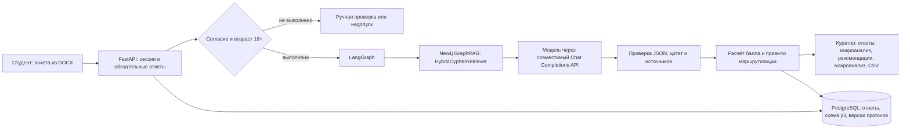

# Архитектура и границы пилота

## Подготовка знаний

`docs/volunteer-questionnaire.docx`, `docs/case.txt` и материалы кейса дают правила, задачи и сведения о программе. В Neo4j загружены 36 версионированных фактов с цитатами и связями ролей/задач. Упоминание совмещения с работой сохранено как повод уточнить фактический график. Работа сама по себе не служит причиной недопуска или штрафа.

`backend/historical.py` нормализует три таблицы, удаляет 55 повторов и фиксирует разбиение 113 уникальных анкет: 90 обучающих в графе, 23 отложенных в `evaluation/holdout-manifest.json`. Исторические ответы участвуют в поиске без прямых идентификаторов. Исторические исходы отделены от новых оценок: старый ноль означает неприглашение, а не оценку по новой рубрике. `backend/knowledge.py` использует официальный `neo4j-graphrag` с `HybridCypherRetriever` и `OpenAIEmbeddings` при наличии ключа. Без него используется штатный полнотекстовый индекс Neo4j с обходом связей графа.

## Путь анкеты

`backend/sessions.py` собирает поля анкеты, проверяет обязательные ответы и возвращает `next_question` для пропущенного поля. Согласие необходимо до записи остальных ответов. Рабочий запуск хранит сессии и версии оценок в PostgreSQL, контакты — в отдельной схеме `pii`; они не передаются модели. Для автономных тестов поддерживается SQLite с отдельным файлом контактов. Изменение ответа создаёт новую ревизию; результаты прогонов остаются версионированными. Снятие согласия удаляет данные сессии.

Алгоритмический безусловный отсев проверяет только согласие и 18+. Для подходящего по этим условиям кандидата `backend/agent_workflow.py` запускает LangGraph: поиск в графе → оценка моделью → правило маршрутизации. Узлы графа используют официальную библиотеку LangGraph, а не самописный агентный цикл. При отсутствии фактов или ошибке модели числовая оценка не подставляется. Для продакшена оценщик принимает адрес и ключ любого совместимого Chat Completions API через `GIM_LLM_ENDPOINT`, `GIM_LLM_API_KEY`, `GIM_LLM_MODEL`. Необязательный `OPENAI_API_KEY` включает векторную составляющую поиска.

Модель выдаёт оценки по шести критериям, точные цитаты ответов и анализ кандидата и программы. Сервер проверяет JSON, допустимые оценки, дословные цитаты и идентификаторы источников, затем сам считает взвешенный балл. Если критерий нельзя обосновать, модель ставит `null`; общий балл тогда не вычисляется. В частности, документы не утверждают необходимый график для каждой роли, поэтому доступность иногда остаётся неизвестной даже при заполненном ответе кандидата.

`backend/decision.py` применяет пилотное правило: балл от 2 из 3 передаёт анкету координатору; при меньшем балле сильный критерий может вызвать дополнительные вопросы, учитывая медиану пяти и более сопоставимых анкет той же рубрики. При малой выборке сравнение помечено как недоступное. Порог 2 и размер выборки 5 являются настройками пилота, их не выдаём за утверждённые правила ГИМ. Дополнительные ответы запускают новую оценку; после одного раунда уточнений вопрос передаётся координатору. Решение о собеседовании и приёме принимает человек.

`frontend/coordinator.html` показывает прогоны, доказательства и вопросы, даёт координатору сохранить исправленную оценку как дочерний неизменяемый прогон и скачать CSV. Административные маршруты требуют `GIM_COORDINATOR_TOKEN`. Анализ содержит краткое описание человека, совместимость с программой в обе стороны, сильные стороны, риски как гипотезы и вопросы собеседования.

Для студента есть маршрут `/student`; куратор входит через `/coordinator` с токеном. Только авторизованный куратор получает все ответы действующей анкеты, включая контакты из `pii`; модель и хранимый снимок её входа контактов не получают. Старые версии показывают сохранённые обезличенные ответы, чтобы изменённые контакты не приписывались прежней версии. `/api/v1/admin/analytics` агрегирует текущие заявки: статусы, направления, рекомендации, средний общий балл и оценки критериев. Закрытые после отзыва согласия сессии исключаются.

## Выбор harness

| Инструмент | Сильная сторона | Решение для этого проекта |
|---|---|---|
| [DeepSeek Harness](https://github.com/deepseek-ai/deepseek-harness) | Плагинная среда для универсального агента | Developer preview с предупреждением о несовместимых изменениях; требует перехода Python-сервиса на Node.js |
| [Google ADK](https://adk.dev/) | Богатая агентная среда, графовые и многоагентные процессы, разные модели | Подходит для более открытого агентного сценария; здесь добавил бы дополнительный агентный слой поверх готовой сессии |
| [OpenAI Agents SDK](https://openai.github.io/openai-agents-python/) | Инструменты, handoffs, guardrails, трассировка | Хорош для агентного цикла с выбором инструментов; здесь выбор шагов заранее определён |
| [Pydantic AI](https://pydantic.dev/docs/ai/overview/) | Типизированные выводы и поддержка многих провайдеров | Подходит для одного вызова модели, но жизненный цикл анкеты уже отделён от вывода |
| [LangGraph](https://docs.langchain.com/oss/python/langgraph/overview) | Явный граф детерминированных и модельных шагов, контроль состояния | Выбран и включён в фактический путь оценки; Python, без смены FastAPI и Neo4j |

LangGraph здесь компилируется без собственного checkpointer: сохранение ревизий и ручной пересмотр уже выполняет PostgreSQL слой сессий. Это исключает вторую копию ответов и контактов в агентном хранилище. В граф передаётся копия анкеты без контактных полей.

## Проверки и ограничения

Автоматические тесты проверяют полный путь с тестовым адаптером модели, пропущенное поле, GraphRAG-контекст, проверку цитат, расчёт и маршрутизацию. Отдельный проверочный вызов Codex CLI во время разработки на синтетической анкете вернул корректный JSON: пять критериев оценены, доступность `null` из-за неизвестного графика роли. `tests/test_dev_model_probe.py` также пропускает этот сохранённый ответ через локальный совместимый HTTP endpoint с фиктивным ключом, реальный LangGraph, сессию и валидаторы; балл остаётся `null` без выдумывания графика. С `GIM_TEST_LIVE_GRAPH=1` тот же тест получает контекст из настоящего Neo4j без ключа эмбеддингов. Codex CLI не входит в серверный пайплайн. Реальный API-вызов продакшен-модели и качество на отложенных 23 анкетах потребуют действующего ключа модели и последующей оценки координатора.
