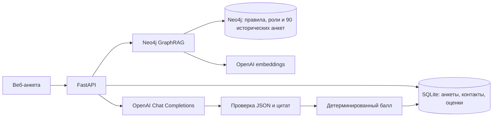

# Текущая архитектура

## Что уже реализовано

- Веб-анкета и FastAPI: `frontend/index.html`, `backend/app.py`, `backend/sessions.py`. Форма создаёт сессию через `POST /api/v1/sessions`, сохраняет ответы через `/sessions/{id}/answers`, запускает оценку через `/sessions/{id}/submit` и получает её через `/sessions/{id}/result`. Старый маршрут `/api/v1/applications` оставлен для совместимости.
- В сессиях контактные ответы хранятся в отдельном файле SQLite `session-contacts.sqlite3`; обычные ответы, ревизии и неизменяемые запуски оценки — в `sessions.sqlite3`. Ключи идемпотентности и тела запросов в основной базе хешируются. Модель получает только поля ответов из белого списка `backend/scoring.py`. Старый маршрут хранит контакты в отдельной таблице того же файла SQLite.
- Отдельный Docker Compose-проект `gim-graphrag` хранит граф в Neo4j. `knowledge/seed.cypher` содержит факты из `docs/volunteer-questionnaire.docx` и PDF, их источники, роли, задачи, критерии и связи. Повторная загрузка использует `MERGE`.
- `backend/historical.py` приводит значения трёх таблиц к общему формату и дедуплицирует 55 весенних копий. До загрузки по фиксированному хешу и с балансом по сезону/старому баллу выделяются 23 анкеты в `evaluation/holdout-manifest.json`. В Neo4j попадают 90 остальных анкет и 134 ссылки на строки источников. Тестовые 23 анкеты и их 34 строки в граф не входят.
- `backend/knowledge.py` использует официальный пакет `neo4j-graphrag`: `OpenAIEmbeddings` и `HybridCypherRetriever`. Гибридный поиск объединяет полнотекстовый и векторный индекс по правилам и обучающим историческим анкетам; Cypher добавляет связи ролей и задач. Старые оценки/исходы хранятся отдельными узлами и не подменяют новую рубрику.
- `backend/eligibility.py` отдельно от балла проверяет согласие и возраст 18+ по дате рождения. Модель не вызывается для кандидата младше 18 лет. Других автоматических причин отказа не установлено.
- `backend/scoring.py` требует шесть оценок 1–3 либо `null`, проверяет точные цитаты из ответов и делает одну повторную попытку при неверном JSON. Если есть `null`, итоговый балл тоже `null`. Иначе `N = Σ(вес × оценка)`, итог `((2N + 25) // 50) / 4`; веса 25/20/20/15/10/10. Решение о приглашении не вычисляется.

## Что ещё не реализовано

- Серверный FSM реализует сессии, ревизии ответов, не более двух запросов на отсутствующее обязательное поле, идемпотентную отправку и отдельный запуск оценки после правки. Веб-форма собирает ответы локально по шагам и передаёт их в сессию при отправке. Интерфейс координатора и административное решение пока не реализованы.
- Нельзя утверждать качество оценок на реальной модели: в окружении нет `OPENAI_API_KEY`. Автоматические тесты проверяют структуру, валидацию и расчёт с тестовым адаптером; настоящий вызов выполняется при запуске `start-scoring.ps1` с ключом владельца.
- Нельзя выводить обязательный минимум часов или расписание конкретной роли из текущих файлов. При недостатке информации критерий доступности остаётся `null`.

Исторические таблицы включены в RAG по подтверждённому пользователем согласию на обработку данных. В поисковый текст входят ответы без столбцов ФИО, даты рождения и контактов; оригиналы остаются в исходных файлах. Исторический ноль означает исход отбора, а не оценку по новой шкале. Вуз, курс, источник анкеты и открытость VK не дают автоматических бонусов или штрафов.

## Проверка в этой рабочей сессии

Текущий ассистент вручную выделил факты из обновлённых документов и загрузил их обычным `cypher-shell`. В базе проверены 29 узлов и 42 связи; цитаты каждого из 29 фактов дословно найдены в указанном исходном файле. Официальный `HybridCypherRetriever` вернул для запроса о квесте узлы `role:project` и `task:quest`, включая связи задачи с критерием и навыком. Для этой проверки поисковому классу подставлен тестовый вектор; вызова OpenAI API не было.

Ручной прогон текущего ассистента на вымышленной анкете: кандидат хочет создавать музейные квесты для посетителей, описывает ранее проведённую игру и обещает заранее предупредить координатора, если не сможет выйти. По подтверждённым ответам получаются мотивация 3, соответствие роли 3, навыки 3, понимание задач 3, ответственность 3. Доступность остаётся `null`: фраза «могу 8 часов по субботам» не доказывает соответствие неизвестному расписанию роли. Итоговый балл также `null`; это ожидаемое поведение, а не ошибка расчёта. Настоящий модельный прогон с API-ключом владельца в этой сессии не выполнялся.
