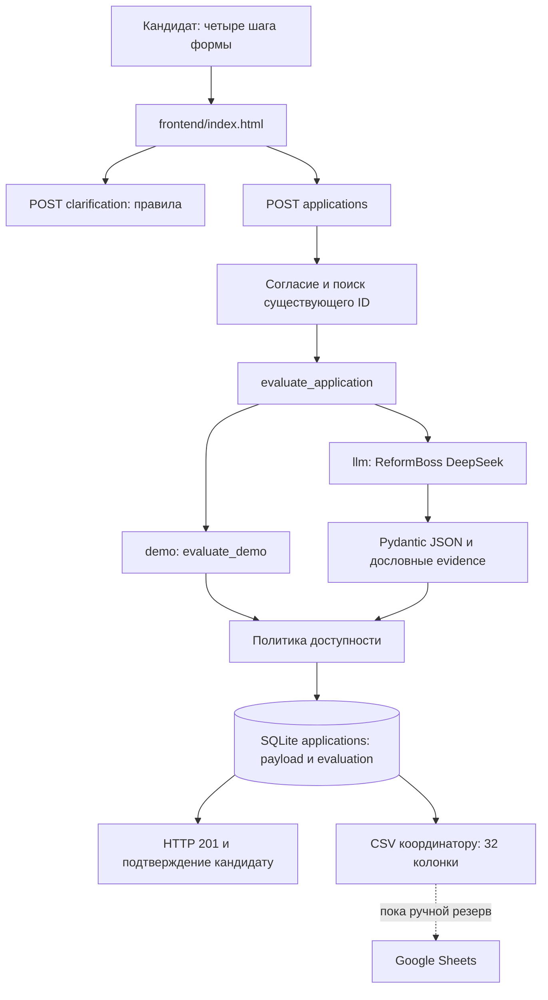
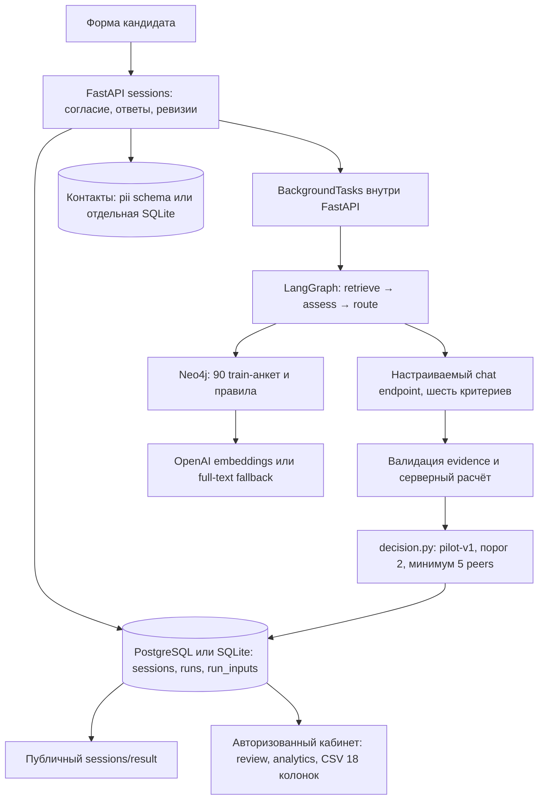

# Архитектура «Музейного компаса»

Сверка 21.10.2026: снимок 20:31 МСК и дополнение по коммитам 20:46–20:47 МСК. Рабочая база — `main@1e5b626`. Состояние веток и воспроизведённые дефекты — [аудит](15-repository-audit-20261021.md); порядок изменений — [план](09-delivery-roadmap.md). Здесь действующий код отделён от предлагаемой эволюции. Экспериментальная ветка не считается внедрённой.

## Действующая сборка main

Путь синхронный: при новой заявке сервер сначала ждёт модель, затем сохраняет строку и отвечает 201. Клиент показывает благодарность и выбранное человеком направление. Уточняющие вопросы формируются правилами, без LLM. В `main` нет `/sessions`, Neo4j, GraphRAG, серверной FSM и автоматической записи в Sheets.

| Компонент | Ответственность и фактический контракт |
| --- | --- |
| `frontend/index.html` | Четыре шага, localStorage-черновик, дополнительные вопросы, постоянный application_id на повтор; внутренние рекомендации на итоговом экране скрыты |
| `backend/app.py` | ApplicationInput, API, consent=false по умолчанию, HTTP 422 без согласия, SQLite и CSV |
| `backend/evaluator.py` | OpenAI-compatible chat/completions, системная инструкция, схема в user payload, response_format=json_object, локальная проверка полей/цитат |
| `backend/availability_policy.py` | Согласованные предварительные сигналы нагрузки с индивидуальными исключениями; без числового штрафа и автоматического отказа |
| `scripts/check_reformboss.py` | Отдельная синтетическая live-проба; тот же timeout, что у launcher |
| `start-reformboss.ps1` | Локальный ввод ключа, выбор свободного порта, mode=llm, timeout=180 с по умолчанию, fallback=false |
| `data/gim.sqlite3` | applications: id, created_at, applicant_name, payload JSON, evaluation JSON. Миграций контактов/assessment_runs в main нет |
| CSV | 32 колонки, `;`, UTF-8 BOM, защита от формул, свёрнутые переносы; выгружает сохранённые applications |
| `tests/`, `run-tests.bat` | Offline unit и настоящий локальный HTTP со временной SQLite; провайдер не требуется |

`score=null`, score_status=not_calibrated. Исторический код 0–3 и предлагаемая рубрика Саши 1–3 с шагом 0,25 — разные сущности. Решение о приёме остаётся за куратором. Выбранное направление и recommended_direction хранятся раздельно.

### Ограничения текущего потока

- Последовательный повтор сохранённого ID возвращает прежний результат и не вызывает LLM. Одновременный повтор пока небезопасен: воспроизведены два запуска оценщика и IntegrityError у одного запроса (#31).
- При сбое LLM новая заявка ещё не записана в SQLite; черновик остаётся только в браузере. Длительное ожидание модели и сохранение анкеты следует развязать при следующем изменении хранения.
- Контакты и ответы пока в одной SQLite. Перед отправкой модели исключаются только applicant_name/application_id; email, vk_url и birth_date остаются в payload. Белый список семантических полей — задача #28.
- HTML скрывает аналитику, но API возвращает её в POST-ответе и открывает чтение заявок/CSV без авторизации. До внешнего размещения нужен серверный контроль доступа (#28).
- health=llm отражает конфигурацию, а не новый успешный вызов провайдера. Последний фактический live-путь подтверждён в [протоколе DeepSeek](14-deepseek-timeout-20261021.md).

## Эксперимент Саши: sanya_gpt_analysis@fe348a5

Коммит fe348a5 добавил LangGraph, PostgreSQL (GIM_DATABASE_URL), кабинет координатора и admin API, CSV сессий, настраиваемые GIM_LLM_ENDPOINT/GIM_LLM_API_KEY и full-text fallback при отсутствии embedding key. Legacy list/get/export тоже защищены. Замечания к 80ae28d об отсутствии admin-route, session-export и жёстком OpenAI chat **сняты**. Синтетическая сессия подтверждена в защищённом admin CSV: HTTP 200, одна строка с её ID.

Полезные модули: eligibility.py, sessions.py, historical.py, scoring.py, knowledge.py; agent_workflow.py и decision.py выделяют этапы и маршрутизацию. Веса 25/20/20/15/10/10, шкала 1–3 с шагом 0,25 и решение not_prioritized_for_interview при низкой оценке — пилотные правила, требующие утверждения. В main score=null, автоматического отказа нет.

Блокеры #32: 72 ложные inclusive-метки, run_inputs после отзыва согласия, полный evaluation в публичном session-result, общий deadline и восстановление BackgroundTasks после остановки процесса. LangGraph здесь не создаёт durable worker. Нужен mapping трёх CSV-контрактов: main 32, legacy 28, admin sessions 18 колонок, и источник для Sheets.

Проверено 62 pytest PASS / 1 live SKIP / 37 subtests. Route-пробы используют синтетические данные, SQLite и fake assessment; PostgreSQL + Neo4j + настоящая модель совместно не проверены. В сохранённом local-rag-comparison.json все четыре условия завершились provider_network_error, valid=false. Это не подтверждает пользу RAG. Пуш ветки и описание запуска не подтверждают развёртывание; на ноутбуке во время проверки Neo4j недоступен. Подробности и исторический снимок — в [аудите](15-repository-audit-20261021.md).

## Предлагаемая эволюция

1. Сохранить SQLite и существующий пользовательский экран. Зафиксировать публичный ответ: приём/ID/статус; служебные выводы — координатору. Принять семантический allowlist перед LLM.
2. Атомарно зарезервировать application_id до дорогой обработки; сохранять ответы и состояние accepted/processing/completed/error. Одинаковый ID не запускает второй evaluator. После ошибки/перезапуска предусмотреть восстановление. Не держать write-lock SQLite весь запрос модели.
3. Выделить один репозиторий заявок/результатов для API, CSV и Sheets. Экспорт по ID должен быть повторяемым и не зависеть от того, пришли ответы из формы или будущей FSM.
4. Подключать DeepSeek через общий интерфейс адаптера. Retrieval — отдельный, необязательный источник контекста. Провайдера embeddings выбрать отдельно; отсутствие OPENAI_API_KEY не должно незаметно менять рабочий путь main.
5. После экспертной приёмки утвердить рубрику, правила нагрузки, источники расписаний и видимость результатов. Только затем пилотировать числовой балл и RAG на фиксированном holdout без дублей. Текущий score=null сохраняется до этого решения.

Для малого корпуса обычный поиск по направлению может быть первым контролируемым экспериментом. Neo4j, PostgreSQL и отдельный кабинет не являются предварительным условием текущего MVP; польза должна подтверждаться качеством рекомендаций. Канал — сайт; VK допустим следующим этапом, Telegram исключён исходным ТЗ.

## Первоисточники

- API: [app.py](../backend/app.py), схема результата: [evaluator.py](../backend/evaluator.py).
- Решения заказчика: [06-gim-stakeholder-answers.md](06-gim-stakeholder-answers.md).
- [Пилот Саши на проверенном SHA](https://github.com/Ai-b0ss/code-with-purpose-2-2026/tree/fe348a5).
- [Последний фикс Ильи 43d9dd4](https://github.com/Ai-b0ss/code-with-purpose-2-2026/commit/43d9dd4).
- Старый PR #10 и contracts/*.json — архивное предложение, не действующий API.
